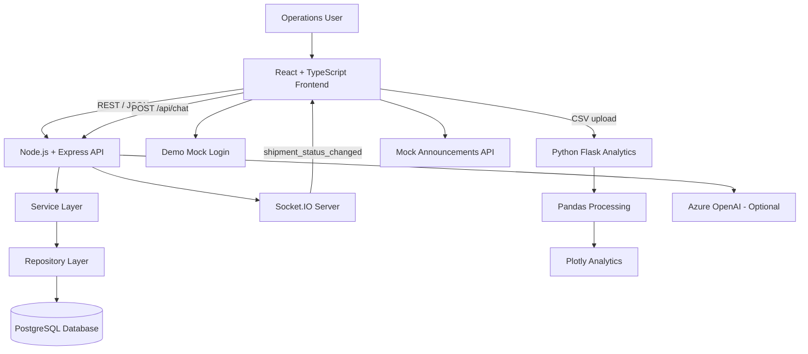

# RBHU OpsHub — System Architecture

## 1. Overview

RBHU OpsHub follows a modular full-stack architecture consisting of a React frontend, a Node.js REST API, a PostgreSQL database and a Python analytics microservice.

Additional integrations provide real-time shipment events and an optional AI assistant.

## 2. Architecture Diagram

## 3. Frontend

The frontend is built with React and TypeScript using Vite.

Responsibilities:

- Render the operations dashboard.
- Manage customer and shipment screens.
- Submit requests to backend APIs.
- Display analytics charts.
- Upload CSV files to the analytics service.
- Receive real-time shipment events.
- Display announcements.
- Provide a demonstration login interface.

## 4. Backend

The Node.js backend uses Express and TypeScript.

The backend follows a layered structure:

| Layer | Responsibility |
|---|---|
| Routes | Define HTTP endpoints |
| Controllers | Handle HTTP requests and responses |
| Services | Apply business logic |
| Repositories | Handle database operations |
| Schemas | Validate request data |
| Middleware | Handle errors and shared processing |
| Sockets | Broadcast real-time events |

Prisma provides database access and migration management.

## 5. Database

PostgreSQL stores customer and shipment information.

Customer and Shipment have a one-to-many relationship: one customer can have multiple shipments.

The Customer model supports soft deletion through its `isActive` field.

## 6. Analytics Microservice

The analytics service is implemented independently using Flask.

Processing flow:

1. Receive CSV upload.
2. Validate the uploaded file.
3. Check required columns.
4. Process the data with Pandas.
5. Calculate summary statistics.
6. Group revenue by region.
7. Identify top salespeople.
8. Return JSON analytics and chart data.

## 7. Real-Time Communication

Socket.IO enables real-time shipment status notifications.

When a shipment status changes, the backend emits:

`shipment_status_changed`

The event contains the shipment ID and updated status.

Connected frontend clients can update their interfaces without refreshing the page.

## 8. AI Assistant

The AI assistant is implemented through the backend `/api/chat` endpoint.

It supports user messages and conversation history. Azure OpenAI credentials and deployment configuration are required for live AI responses.

## 9. Announcements

The announcements endpoint currently returns sample in-memory data.

A future production version can retrieve announcements from SharePoint or a dedicated database.

## 10. Design Principles

- Separation of concerns.
- Reusable frontend components.
- API-based communication.
- Request validation.
- Centralized error handling.
- Independent analytics service.
- Environment-based configuration.
- Real-time event-driven updates.