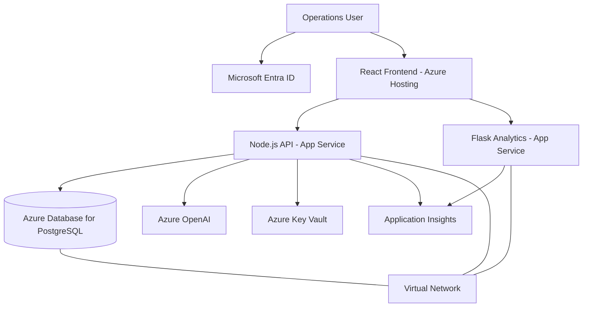
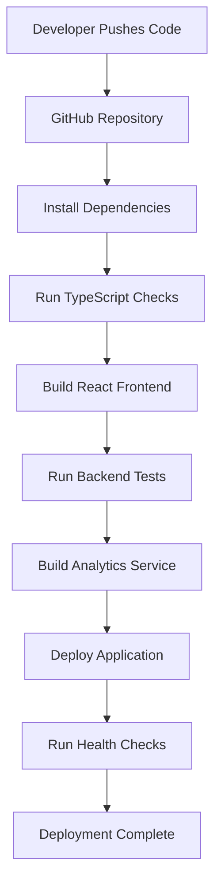

# RBHU OpsHub — Azure Deployment Architecture

## 1. Deployment Status

This document describes a proposed Azure deployment architecture.

The current application is developed locally. Its development PostgreSQL database uses Neon. Azure production deployment is not yet implemented.

## 2. Proposed Azure Services

| Application component | Proposed Azure service |
|---|---|
| React frontend | Azure App Service or Azure Static Web Apps |
| Node.js API | Azure App Service |
| Python analytics | Separate Azure App Service |
| PostgreSQL | Azure Database for PostgreSQL Flexible Server |
| Secrets | Azure Key Vault |
| Identity | Microsoft Entra ID |
| Network isolation | Azure Virtual Network and Private Endpoints |
| Monitoring | Azure Application Insights |
| CI/CD | GitHub Actions or Azure DevOps |

## 3. Proposed Architecture

## 4. Application Hosting

Deploy the React frontend and backend as independently managed application components.

The Python analytics service can be deployed separately to support independent scaling and maintenance.

Configure application settings through the hosting platform instead of hardcoding secrets.

## 5. Database

Use Azure Database for PostgreSQL Flexible Server.

Recommended configuration:

- Private network connectivity where supported.
- TLS connections.
- Automated backups.
- Database access restricted to authorized application services.
- Prisma migrations executed as part of controlled deployment.

## 6. Identity and Access

Integrate Microsoft Entra ID for enterprise authentication.

Proposed controls:

- User authentication through Entra ID.
- Role-based authorization.
- Least-privilege access.
- Managed identities for supported Azure resource access.

The current frontend login is mock authentication and must be replaced before production.

## 7. Secrets Management

Use Azure Key Vault for:

- Database connection credentials.
- AI service credentials.
- Other application secrets.

Use managed identities where possible to access Key Vault without embedding credentials in application code.

## 8. Network Security

Proposed network controls:

- HTTPS for application traffic.
- Virtual Network integration.
- Private endpoints for supported managed services.
- Restricted database access.
- Carefully configured CORS.
- Network security rules based on least privilege.

Exact networking configuration depends on the selected App Service plans, deployment model and Azure region.

## 9. CI/CD Pipeline

Proposed GitHub Actions workflow:

Suggested pipeline stages:

1. Trigger on pull request or approved branch push.
2. Install dependencies.
3. Run linting and type checks.
4. Build frontend and backend.
5. Run automated tests.
6. Deploy to staging.
7. Run health checks.
8. Approve production deployment.
9. Deploy production application.

## 10. Monitoring

Use Application Insights to monitor:

- API request latency.
- Failed requests.
- Application exceptions.
- Dependency failures.
- Service availability.

## 11. Production Readiness Checklist

- Replace mock login with Entra ID.
- Implement authorization.
- Configure Key Vault.
- Configure private database access.
- Enable HTTPS.
- Set up backups.
- Add automated tests.
- Configure monitoring and alerts.
- Configure CI/CD.
- Review CORS and security headers.