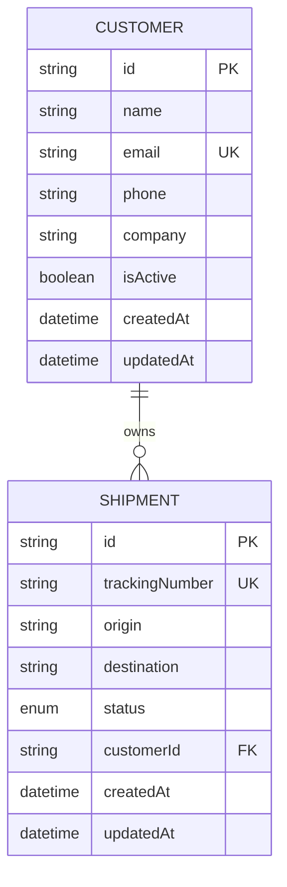

# RBHU OpsHub — Database Schema

## Database

PostgreSQL

ORM: Prisma

The development database is hosted on Neon PostgreSQL.

## Entity Relationship Diagram



## Customer

| Field | Type | Description |
|---|---|---|
| id | String | UUID primary key |
| name | String | Customer name |
| email | String | Unique email |
| phone | String? | Optional phone |
| company | String? | Optional company |
| isActive | Boolean | Soft-delete flag, default true |
| createdAt | DateTime | Creation timestamp |
| updatedAt | DateTime | Last update timestamp |

## Shipment

| Field | Type | Description |
|---|---|---|
| id | String | UUID primary key |
| trackingNumber | String | Unique tracking number |
| origin | String | Shipment origin |
| destination | String | Shipment destination |
| status | ShipmentStatus | Current shipment status |
| customerId | String | Customer foreign key |
| createdAt | DateTime | Creation timestamp |
| updatedAt | DateTime | Last update timestamp |

## ShipmentStatus Enum

- PENDING
- PROCESSING
- IN_TRANSIT
- DELIVERED
- CANCELLED

## Relationship

One Customer can have multiple Shipments.

Every Shipment belongs to one Customer through `customerId`.

## Indexing and Constraints

- Customer email is unique.
- Shipment tracking number is unique.
- Primary keys use UUID values.
- Shipment customer references use a foreign key relationship.

## Migration Management

Prisma migrations are stored in:

`backend/prisma/migrations`

Development migration:

```bash
npx prisma migrate dev --name migration_name
```

Apply existing migrations:

```bash
npx prisma migrate deploy
```

Generate Prisma client:

```bash
npx prisma generate
```

## Future Improvements

- Add indexes for frequently searched shipment fields.
- Add audit logs for status changes.
- Add user and role tables.
- Add announcement persistence.
- Define retention and backup policies.