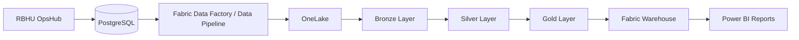

# RBHU OpsHub — Microsoft Fabric Readiness

## 1. Objective

This document proposes how RBHU OpsHub could integrate with Microsoft Fabric to support enterprise reporting, analytics and business intelligence.

This is an architectural design. Microsoft Fabric is not currently connected to the application.

## 2. Proposed Data Flow

## 3. Data Sources

Potential source data:

- Customer records.
- Shipment records.
- Shipment status history, once audit history is implemented.
- Sales CSV analytics.
- Operational event records.

## 4. Medallion Architecture

### Bronze

Store raw ingested data with source and ingestion metadata.

### Silver

Clean, validate and standardize the data.

Examples:

- Standardize shipment status values.
- Validate customer identifiers.
- Normalize region names.
- Handle missing sales values.

### Gold

Create business-ready datasets.

Potential tables:

- FactShipments
- FactSales
- DimCustomer
- DimRegion
- DimDate
- DimSalesperson

## 5. Potential KPIs

| KPI | Description |
|---|---|
| Total Shipments | Number of shipment records |
| Delivered Shipments | Number of delivered shipments |
| Delivery Rate | Delivered shipments divided by total eligible shipments |
| In-Transit Shipments | Shipments currently in transit |
| Regional Revenue | Sales revenue grouped by region |
| Salesperson Performance | Revenue grouped by salesperson |

## 6. Security and Governance

- Use approved identity and access controls.
- Apply least-privilege permissions.
- Protect customer information.
- Use sensitivity labels where appropriate.
- Maintain data lineage.
- Apply retention policies.
- Separate development and production workspaces.

## 7. Implementation Roadmap

1. Identify operational reporting requirements.
2. Define source-to-target mappings.
3. Configure a Fabric workspace.
4. Establish secure data connectivity.
5. Build ingestion pipelines.
6. Implement Bronze, Silver and Gold transformations.
7. Create semantic models.
8. Publish Power BI reports.
9. Validate data quality and refresh schedules.

## 8. Expected Benefits

- Centralized reporting.
- Historical operational analysis.
- Cross-region sales comparisons.
- Shipment performance monitoring.
- Scalable enterprise analytics.