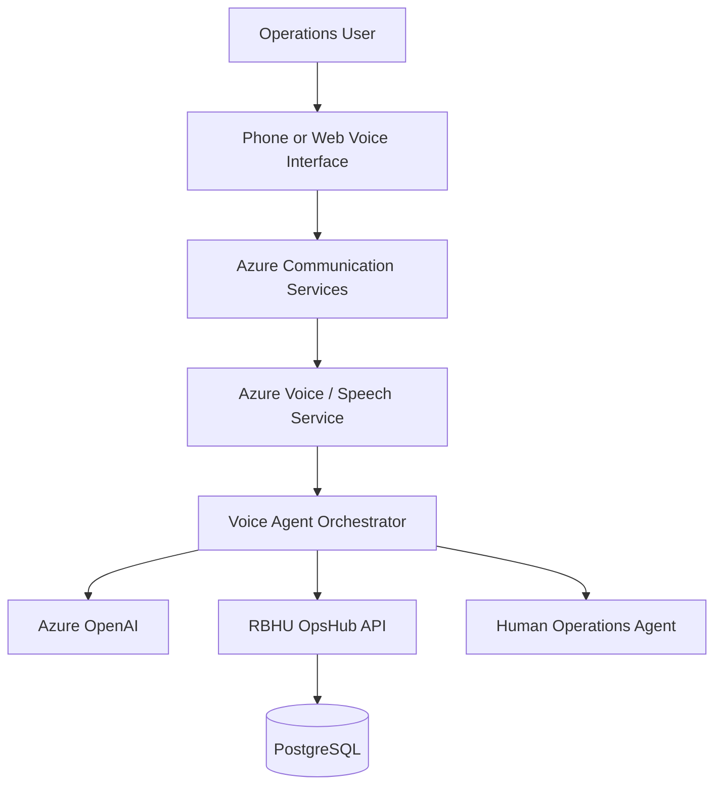

# RBHU OpsHub — Voice Agent Architecture

## 1. Objective

This document proposes a voice-enabled operations assistant for RBHU OpsHub.

The design uses Azure Communication Services and Azure AI services as potential integration options. No live voice agent is currently deployed.

## 2. Proposed Use Cases

- Ask for shipment tracking information.
- Understand shipment status terminology.
- Ask operational process questions.
- Receive assistance with customer workflows.
- Escalate complex requests to a human operator.

## 3. Proposed Architecture

## 4. Conversation Flow

1. User initiates a voice session.
2. The voice interface captures audio.
3. Speech processing converts the request into text.
4. The agent interprets the request.
5. The agent uses approved backend APIs when operational data is needed.
6. The response is converted into speech.
7. The user receives the spoken response.

## 5. Example Interaction

User: "Can you explain what In Transit means?"

Agent: "In Transit means the shipment is currently moving from its origin towards its destination."

A future implementation could support tracking-number lookup through authenticated backend APIs.

## 6. Integration Requirements

- Voice interface.
- Speech recognition and speech synthesis.
- Conversation orchestration.
- Azure OpenAI or another approved language model.
- Secure backend API access.
- Authentication and authorization.
- Logging and monitoring.

## 7. Security Considerations

- Authenticate users before exposing shipment information.
- Restrict access to customer records.
- Avoid speaking sensitive information to unauthorized callers.
- Protect audio and transcript data.
- Apply retention controls.
- Provide a human escalation option.

## 8. Future Implementation Steps

1. Select the voice interaction channel.
2. Configure the required Azure communication and speech resources.
3. Build the voice orchestration service.
4. Integrate the assistant with authorized backend APIs.
5. Implement authentication.
6. Test speech recognition and response quality.
7. Add monitoring and fallback handling.